# Assignment 1 – Infrastructure Management  
**Course Code:** (S1-25_CCZG538)

## 📝 Chosen Topic

**Configure a load balancer for a web application. Document how traffic is distributed across backend servers.**

This repository demonstrates how a load balancer (NGINX) is configured to distribute traffic across three backend servers using Docker containers. The setup follows infrastructure management best practices and provides a production-relevant architecture, complete with configuration files, source code, container orchestration via Docker Compose, and screenshots verifying successful implementation.

---

## ✅ Assignment Requirements & Compliance

| Requirement | Status | Notes |
|------------|--------|-------|
| Original Work | ✅ | All content, code, and analysis are self-developed |
| Length (2–3 pages) | ✅ | Covered in the PDF submission |
| Credible Support | ✅ | Demonstrated via structured documentation and real behavior |
| Diagrams | ✅ | Screenshots used as visual verification |
| Feasible Design | ✅ | Uses NGINX + Docker Compose setup suitable for real-world usage |
| Design Reasoning | ✅ | Explained in traffic flow and architecture sections |
| Professional Docs | ✅ | This README + submitted PDF provide structured documentation |

---

---

## ⚙️ Architecture Overview

This project deploys a simple web server architecture as displayed below:

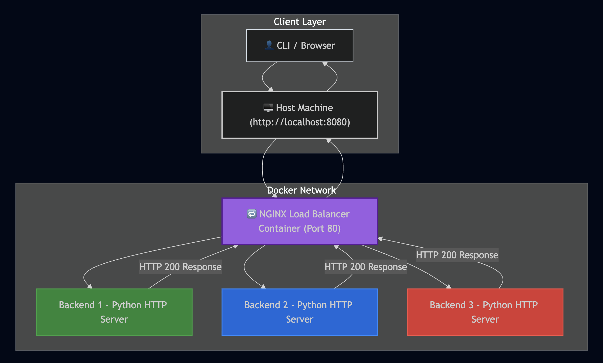

- A **load balancer (NGINX)** is exposed on `http://localhost:8080` on the host machine.
- NGINX listens on port `80` **inside the container**, as configured in `nginx.conf`.
- Incoming traffic is **reverse proxied** to one of the three **backend containers**, each running a Python HTTP server on port `8000`.

Port Mapping Overview:

| Layer | Port | Role |
|-------|------|------|
| Host Machine | `8080` | Entry point for testing via browser or curl |
| NGINX Container | `80` | Receives requests and balances them |
| Backend Containers | `8000` | Serve HTTP responses to NGINX |

Traffic distribution is handled by NGINX using its **default round-robin** algorithm, ensuring even load across backend servers.

---

## 🔁 Traffic Distribution Explained

Traffic sent to the load balancer is evenly distributed among the three backend containers in a round-robin fashion.

This is evidenced by:

- **Curl loop test** (`for i in {1..10}; do curl http://localhost:8080; echo; done`) confirming sequential routing of requests across all servers.
- **Browser access attempts** showing responses from different backend servers on each refresh.

---

## 🖼️ Screenshot Evidence

Below are the annotated screenshots demonstrating the complete setup, execution, and proof of load balancing.

### 1. 📂 Project Directory Structure

Shows the structure of the assignment folder with all necessary files.

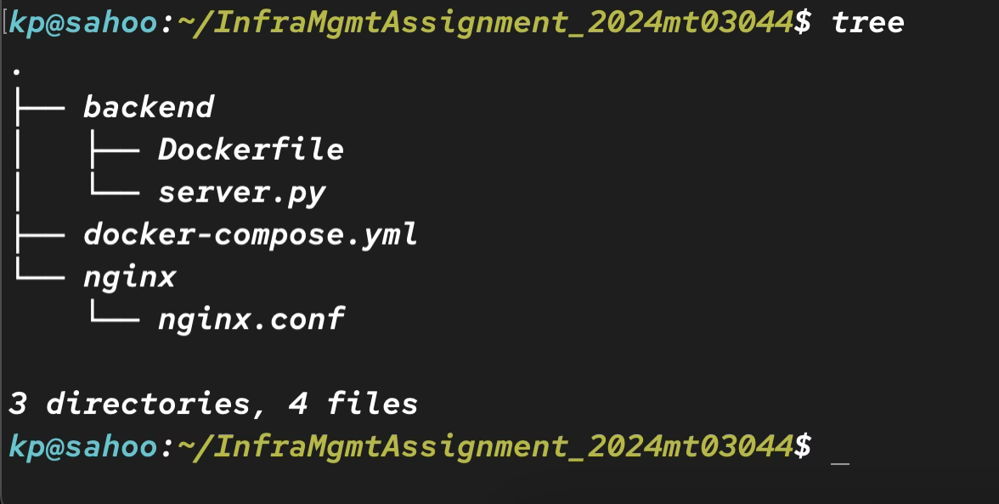

---

### 2. 📄 NGINX Configuration File

Displays the contents of `nginx.conf`, defining upstream servers and load balancing rules.

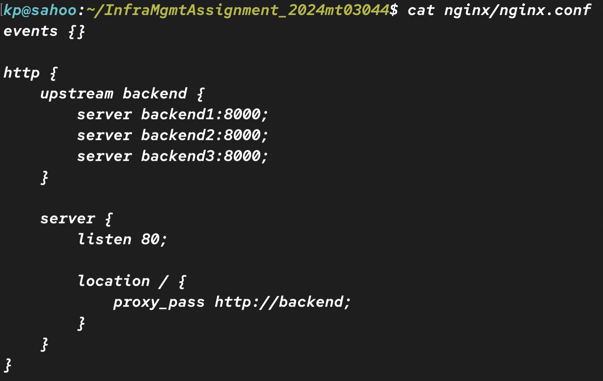

---

### 3. 📄 Docker Compose Code

Shows `docker-compose.yml` defining services for NGINX and backend servers.

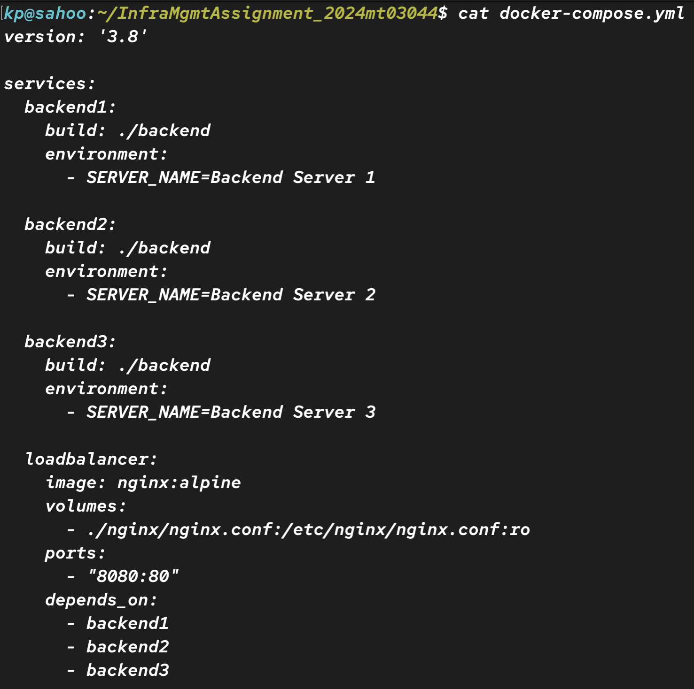

---

### 4. 🔧 Backend Dockerfile & Server Code

Contains both the `Dockerfile` and the simple Python `server.py` script for the backend.

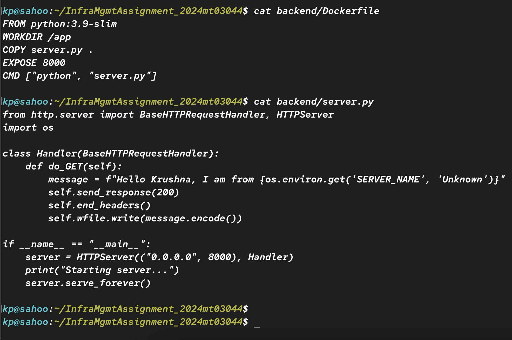

---

### 5. 🛠️ Docker Image Build (Start)

Shows Docker Compose initiating the build process and pulling required base layers.

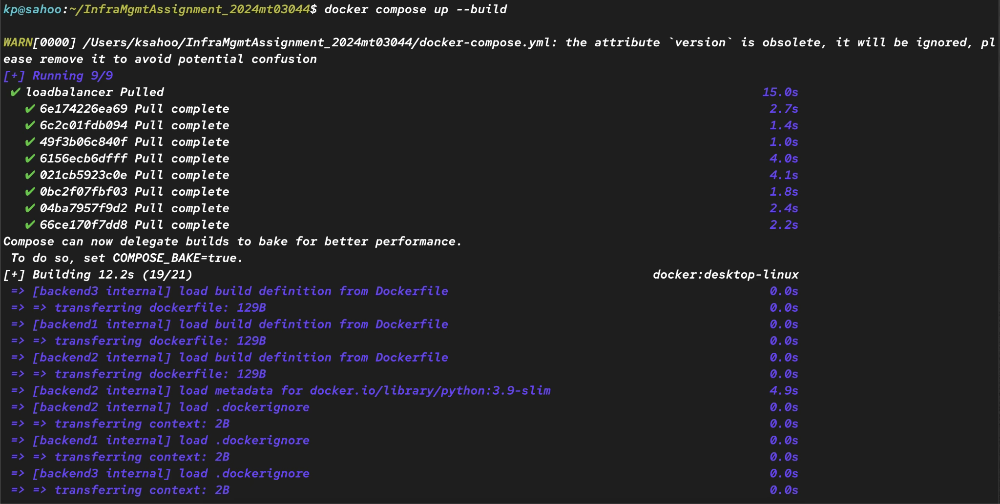

---

### 6. ✅ Docker Image Build Complete + Containers Running

Confirms successful image creation and container launch, including HTTP response code 200 log output.

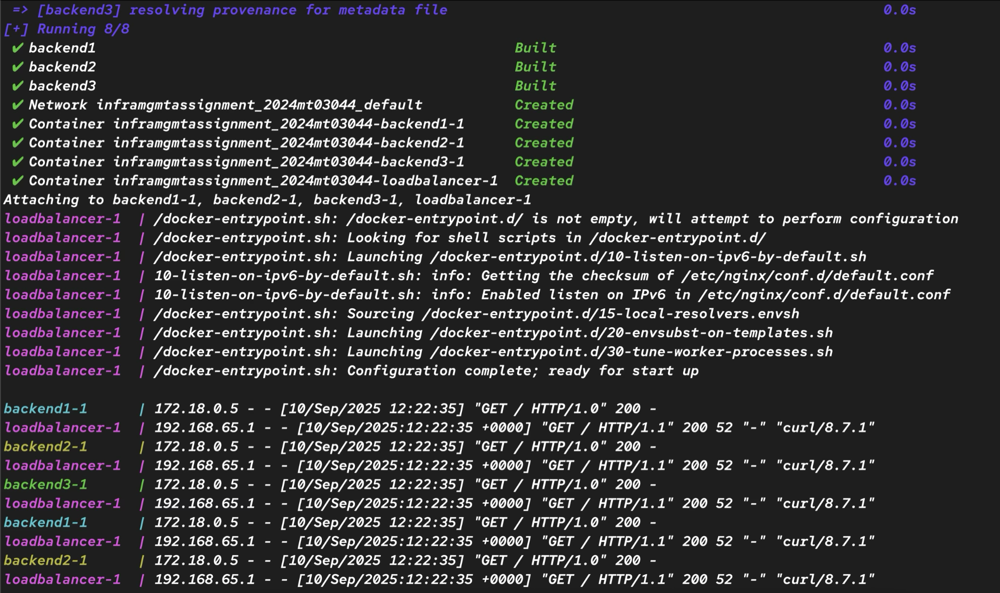

---

### 7. 📦 Running Containers

Displays running containers using `docker ps`, including the load balancer and backend containers.

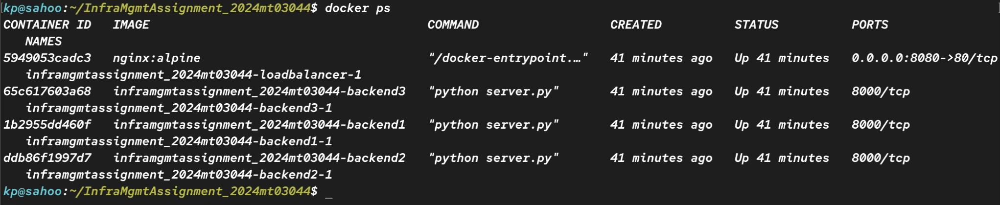

---

### 8. 🔁 Curl Loop Test

Shows sequential curl requests routed to different backend servers, validating round-robin logic.

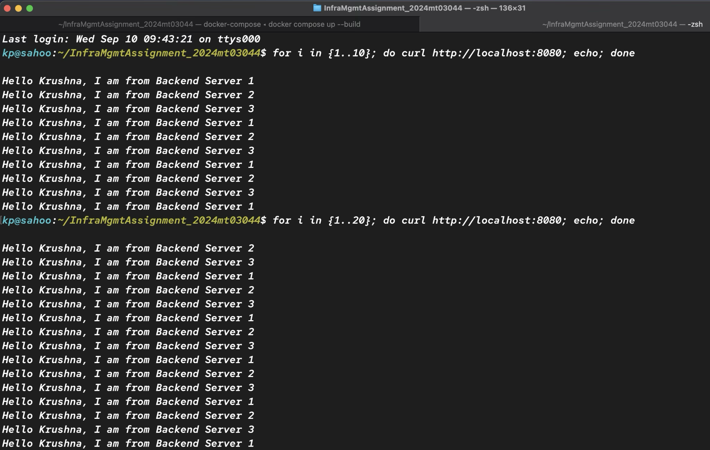

---

### 9. 🌐 Web Access Attempt 1

Browser shows response from Backend Server 2.

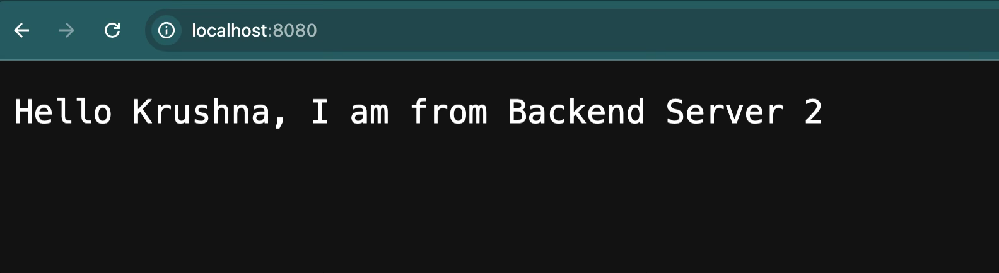

---

### 10. 🌐 Web Access Attempt 2

Browser shows response from Backend Server 1.

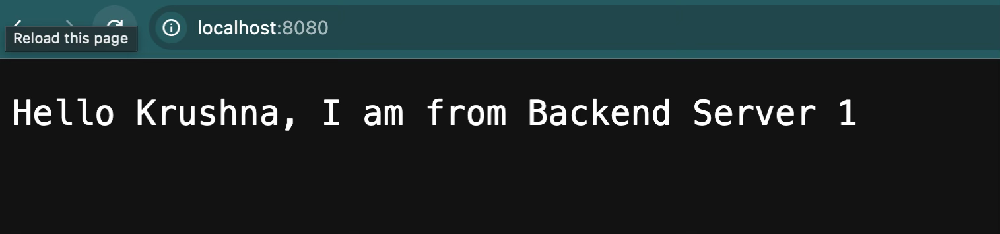

---

### 11. 🌐 Web Access Attempt 3

Browser shows response from Backend Server 3.

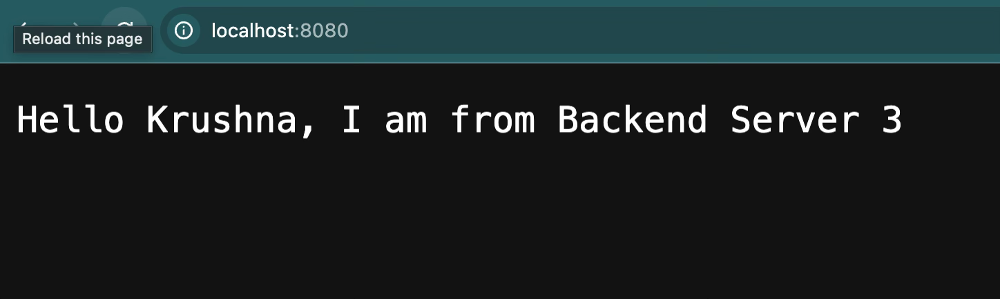

---

## 📌 Summary

This project showcases a complete, working implementation of a load-balanced web service using NGINX and Docker. Traffic is successfully routed across multiple backend containers using round-robin, providing both scalability and high availability.

The design is modular, extensible, and demonstrates infrastructure principles covered in the course.

---

## 👨‍🎓 Author

- **Name:** *Krushna Prasad Sahoo*  
- **Student ID:** *2024MT03044*  
- **Course:** Infrastructure Management  
- **Instructor:** *SIDHARTH MOHAPATRA*

---

## 📘 License

This repository is submitted as part of the academic assignment for **Infrastructure Management (S1-25_CCZG538)**. All rights reserved to the author.
